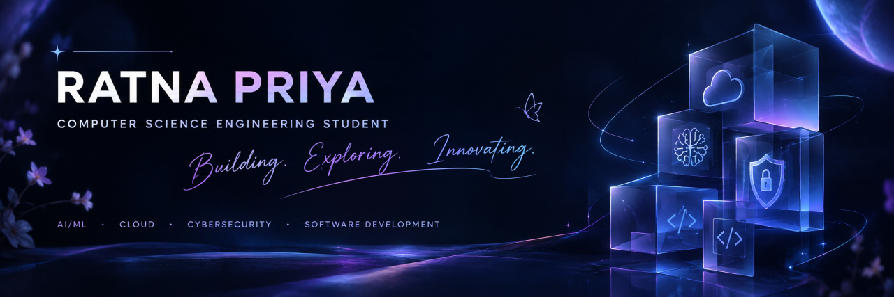

<!-- PROFILE BANNER -->

  

 

 

---

## ✨ About Me

Hey! I'm **Ratna Priya**, a second-year Computer Science Engineering student from Chennai, India.

I'm passionate about exploring the intersection of **Artificial Intelligence, Cloud Computing, Cybersecurity, and Software Development.**

I enjoy learning by building, experimenting with technologies, solving programming challenges, and transforming ideas into practical applications.

- 🎓 Computer Science Engineering student.
- 💻 Exploring AI, Machine Learning, Cloud Computing and Cybersecurity.
- 🔐 Interested in Cloud Security, IAM and cloud misconfigurations.
- 🚀 Building practical applications and experimenting with new technologies.
- 🧩 Strengthening my programming and problem-solving skills.
- ♟️ National-level chess player with a passion for strategic thinking.
- 🌱 Always curious, always learning.

> "Curiosity drives innovation. Consistency turns ideas into reality."

---

## 💻 Tech Stack & Technologies

### Programming Languages

### Web Development

### Cloud, Database & Development Tools

### AI & Data Science

*Currently expanding my knowledge across these technologies through coursework, projects and independent learning.*

---

## 🚀 Featured Projects

<table>
<tr>
<td width="50%" valign="top">

### 🏡 RealEstateHub

A Java-based web application designed to manage real estate listings and customer enquiries.

**Tech Stack:**
- Java
- JSP
- MySQL
- HTML & CSS

</td>
<td width="50%" valign="top">

### 🎙️ Voice Statement Retriever

An AI-assisted voice-based application concept for retrieving bank statements through a consent-based workflow with human approval.

**Tech Stack:**
- React
- Python
- FastAPI

</td>
</tr>
<tr>
<td width="50%" valign="top">

### 💓 VitaPulseAI

An AI-focused healthcare project exploring intelligent digital solutions through a modern web application.

**Tech Stack:**
- React
- JavaScript
- Tailwind CSS
- PostgreSQL

</td>
<td width="50%" valign="top">

### 💡 More Projects Coming Soon!

Continuously experimenting with new ideas, exploring emerging technologies and building projects to strengthen my development skills.

</td>
</tr>
</table>

---

## 🏆 Achievements & Recognition

- 🥈 **Silver Medalist** – 55th Tamil Nadu State Women’s Chess Championship 2026.
- ♟️ Selected to represent **Anna University** at the Inter-College South Zone Chess Championship.
- 🌐 Selected for **Google Student Ambassador Program 2026**.
- 🚀 **Google Startup School** – Prompt to Prototype Graduate.
- 🎓 **NPTEL Elite Certification** – Python for Data Science, IIT Madras (76%).
- 💡 Selected for **Infosys Springboard Pragati Cohort 9**.
- 🌍 **College Ambassador** – Techfest, IIT Bombay.
- ☁️ Microsoft Learn badges – Overview of AI Concepts and Get Started in Microsoft Foundry.
- 💻 Completed 100+ programming exercises on SkillRack.

---

## 📊 GitHub Analytics

  

  

    

  

---

## 🐍 Contribution Journey

---

## 🌱 Currently Exploring

| Domain | Learning Focus |
|---|---|
| ☁️ Cloud Computing | Cloud infrastructure and AWS |
| 🔐 Cybersecurity | IAM, cloud security and misconfigurations |
| 🤖 Artificial Intelligence | AI/ML concepts and applications |
| 💻 Programming | C++, Java, Python and DSA |
| 🌐 Development | Full-stack application development |

---

## 🎯 Beyond Coding

Not everything is about code!

♟️ Chess – National-level player, strategic thinker and lifelong learner.

📚 Learning – Exploring new technologies and continuously improving my skills.

💡 Innovation – Enjoy experimenting with ideas and building useful solutions.

🤝 Collaboration – Interested in connecting with developers, innovators and tech communities.

---

## 🤝 Let's Connect!

I'm always open to connecting with fellow developers, collaborating on interesting projects, sharing knowledge and exploring new opportunities.

<!-- Add your LinkedIn profile URL here -->

  

### 💜 Thanks for stopping by!

*Keep learning. Keep building. Keep growing.*

